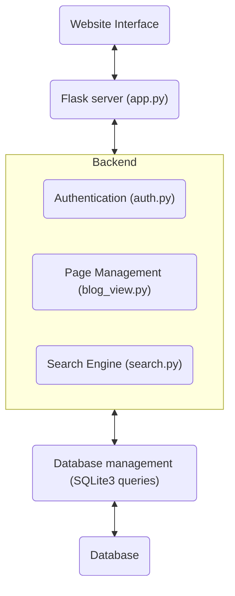
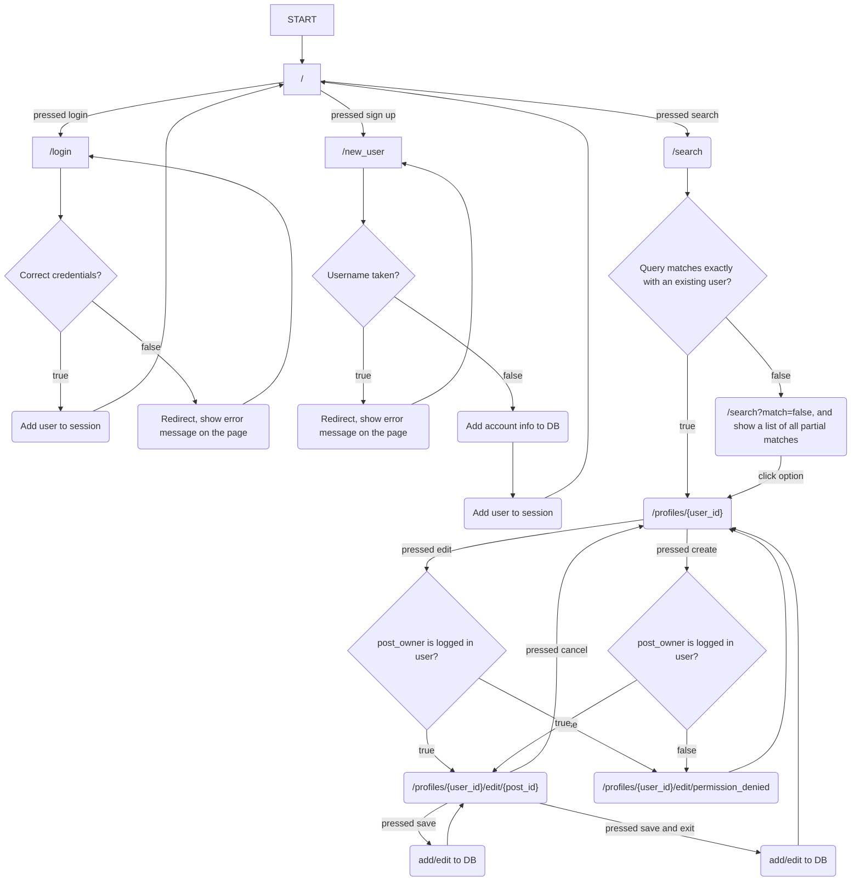
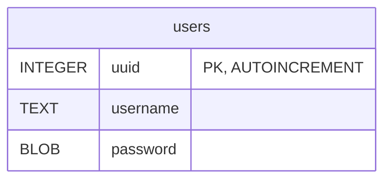
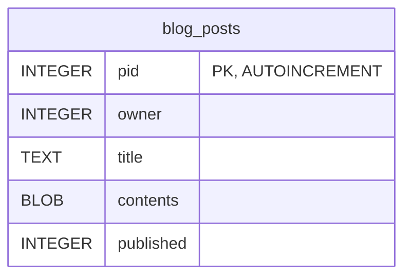

# System Blueprint (_a.k.a._ "Design Doc")

## TNPG: Hypergamy
## project: WeBlog
## Target ship date: {2026-11-18}

---

#### roster:

| Name | Email | Primary Role | Secondary Role |
|---|---|---|---|
| Leon Wong | leonw17@nycstudents.net | Databases | Backend |
| Marcos Lehman | marcosl30@nycstudents.net | Webpage Design | Backend |
| Wenjie Ma | wenjiem@nycstudents.net | Webpage Design | Databases |
| Efrat Hossain | efrath3@nycstudents.net | Backend | Databases |

---

# Summary
Super awesome blog hosting and sharing site, where you can update your own blog and see blogs of other users.

## Problem Being Solved
Have you ever wanted to have blog posts 'n' stuff, but don't want to pay ten thousands of $$$ to the tech overlords to get it? Well now there is one, for free! (we're not the ones paying for it lol)

## Target Users

Who will use this system?

- People who want blog posts
- People who want to look at them
- ~~Sam Altman's web crawlers~~

## Why This Project Matters
If we make it, we get good experience for teamworking and making a project. ~~also we get a good grade in the class~~

---

# Minimum Viable Product (MVP) Scope

## Core Features (Required for Final Submission)
Features that **must** be completed:
1. Login/logout/storing info on accounts in databases
1. Seeing the blog posts of a specific user
1. A way to edit your blog posts.
1. Seeing all your unpublished / published blog posts, and being able to publish/unpublish them.

## Stretch Features (Only if MVP is Complete)
1. No edit or create button appearing on posts that aren't yours. (The buttons won't work on posts you don't own anyways)
1. Let users create a bio, maybe even a profile image?
1. Super stretch: A main feed that shows blog posts from multiple users (these are just the most recently published ones)

## Explicit Non-Goals
- Live rendering of the html text as you edit it.

Features intentionally excluded:
- View counter. It's too hard for many reasons.

---

# Technology Stack

| Layer | Selected Tool |
|---|---|
| Backend Framework | Flask |
| Frontend Framework | none |
| Database | SQLite |
| Authentication | Flask sessions  |

## Why This Stack Was Chosen
This section and the one above it fixed/given for Project0

---

# Team Ownership Plan

Each member must own meaningful deliverables.

| Team Member | Primary Ownership | Secondary Ownership | Specific Deliverables |
|---|---|---|---|
| Marcos | Databases | Backend | Login System, Storing Blog Posts |
| Wenjie | Webpage Design | Backend | Create webpages design |
| Leon | Webpage Design | Databases | Create webpages design |
| Efrat | Backend | Databases | Routing routes |

---

# Component map

# Site map

## Key User Stories
### eg0
As a writer, I want to make the blog posts so that people think I'm supa cool.

### eg1
As a person, I want to read other people's blog posts so that I can get dopamine.

### eg2
As a web crawler, I want to eat all the blog posts so that I can make my masters rich.

# Database Design

### Example of populated DBs
users
|uuid INTEGER PRIMARY KEY|username TEXT|password BLOB|
|---|---|---|
|1|coldmuffin|\(hashed password\)|
|2|john_doe_|\(hashed password\)|
|3|jawed|\(hashed password\)|

blog_posts
|pid INTEGER PRIMARY KEY AUTOINCREMENT|owner INTEGER|title TEXT|contents BLOB|published INTEGER|
|---|---|---|---|---|
|1|3|Going to the zoo today!|\(the html file of the blog post\)|1|
|2|2|Generic Manifesto|\(the html file of the blog post\)|0|
|3|2|Looking for Janes...|\(the html file of the blog post\)|1|

Note about published: 1 means post is public (anyone can see it), 0 means unpublished (only the owner can see it)

# Testing Plan
{Delineate here your plan for testing each component}

# Timeline
## day0 Goals:
## ...
## dayX Goals:
## Internal Deadlines:
{List milestones your team has identified, in the order they must be completed. Set a target completion date for each.}

# Completion Criteria (_a.k.a._ "Definition of 'Done'")
Project is considered complete when all of the following are true:
1.
1.
1.

# Open Questions
{Delineate anything undecided here}

# Appendix
{Any relevant info that is useful but would have interrupted narrative flow above, or cluttered the information portrayed}

# Other
{Put here anything that did not sensibly fit under above headings. This section will inform evolution of SoftDev.}
